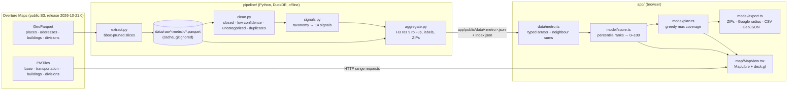

# Architecture

## One-paragraph version

A Python pipeline reads Overture's public GeoParquet on S3 with DuckDB, keeps the parts of four themes that overlap each metro, cleans the places, and aggregates everything to H3 resolution-9 cells. It writes one columnar JSON file per metro into `app/public/data/`. The web app is a single page, served by a small Node server that also hosts the optional AI API (any static host works without AI). It loads a metro file, ranks every cell for the user's weights, greedily places radius pins, and renders the result over an Overture basemap streamed as PMTiles. Every interaction recomputes synchronously in under ~60 ms, and the URL hash holds the full plan.

## Data flow



There are two network dependencies at runtime, both read-only and both public:

1. **Overture PMTiles** (`overturemaps-extras-us-west-2.s3.amazonaws.com/tiles/<release>/…`) for the basemap.
2. **Protomaps glyphs** (`protomaps.github.io/basemaps-assets/fonts/…`) for map label fonts.

Everything the app *computes* comes from the bundled metro files. The optional third dependency is the app's own server (`app/server/`). It serves the built files and an `/api` that calls OpenAI for the two AI features, and it is the only place the API key exists. See [ai.md](ai.md).

## Repository map

```
pipeline/
  catchment/
    config.py      release, metros (bbox, centre, zoom), H3 resolution, cleaning thresholds
    db.py          DuckDB connection (spatial + h3 + httpfs), small row helpers
    extract.py     S3 → data/raw/<metro>/<type>.parquet, cached
    clean.py       place cleaning rules + ledger of every drop
    signals.py     the 14 signals and their taxonomy rules (SQL + Python twin)
    cells.py       pure helpers: ZIP normalisation, neighbour-ring fill
    aggregate.py   roll-up to cells, labels, ZIPs, writes the metro JSON
    __main__.py    CLI: extract | build | all
  tests/           pytest, offline (in-memory DuckDB)
app/
  public/data/     built metro files (committed) + index.json
  server/          Node server: static files + /api (AI). Runs TypeScript directly (Node ≥ 22.18)
    ai/            brief → plan and ad angles: schemas, prompts, validation, grounding
    share.ts       link-preview pages (/s) and uploaded plan snapshots
  mcp/             MCP server: the planner as agent tools (stdio)
  e2e/             Playwright flows + axe accessibility audit
  src/
    ai/            AI client, AI store, BriefBox
    data/          file types; buildMetro() → typed arrays, neighbour sums, place→cell
    model/         factors, profiles, scoring, planner, exports (pure, unit-tested)
    state/         zustand store, URL codec, theme store
    map/           basemap style + palettes, score colour ramps, MapView
    ui/            panels, cell card, dialogs, Select, Tooltip, tour/
docs/              you are here
render.yaml        static-site deploy
.github/workflows/ci.yml
```

## Boundaries and invariants

- **The data file is the contract.** The pipeline writes it and the app reads it. The schema lives twice: `aggregate.py` writes it and `app/src/data/types.ts` types it. Change both together, and see [data-format.md](data-format.md).
- **The model layer is pure.** `app/src/model/*` imports no React, no map code and no browser APIs. It takes a `Metro` and plain options and returns plain data. That's what makes it testable and fast to reason about.
- **Deterministic plans.** Given the same metro file and the same URL, `planPins` returns the same pins. Ties break on cell index, and nothing is random. Shared links depend on this.
- **One release everywhere.** The pipeline (`config.RELEASE`), the data files (`release` field) and the basemap tiles (`basemapStyle(release, …)`) use the same Overture release, so the map and the numbers always agree.
- **AI proposes, the engine decides.** Models choose inputs (weights) or wording (ad hooks), never scores or pins. AI output is schema-constrained, validated on the server, and reviewed by the user before it changes anything.
- **Secrets stay server-side.** The OpenAI key is only read by `app/server/main.ts`. The browser bundle is checked to contain no trace of it.
- **One model, three surfaces.** The browser app, the AI server and the MCP server all call the same pure functions in `app/src/model/`, so a plan is identical wherever it's made.
- **A minimal backend.** The only server-side code is the static file server and the AI proxy. Accounts, saved plans and ad-platform push are deliberately out of scope. See [decisions.md](decisions.md).

## Request lifecycle (what happens when you click a weight)

1. `BusinessPanel` calls `store.setWeight(factor, w)`.
2. The store's `recompute()` runs `scoreCells()` (~5–30 ms) then `planPins()` (~15–60 ms) on the current metro, and writes the new state and URL hash (`history.replaceState`).
3. React re-renders the panels. `MapView` pushes new deck.gl layer props, and cell colours transition over 450 ms.
4. Pin markers that are new to the plan animate in. Unchanged pins stay still.

Nothing is fetched, and nothing is async after the metro file has loaded.
